# OpenMind — interface review, 17 Oct 2026

A walk through the running product in Chromium, from the front door to a graded session and
the teacher console, at desktop and phone sizes. **15 findings ranked by severity**, each with
the screenshot it was observed in, the exact location, and a way to verify the fix.

No application file, configuration file or live learner record was changed for this review.
Every action ran against a **scratch store** (`OPENMIND_DATA_DIR=/tmp/openmind-ui-audit-2026-10-17/data`);
`find .openmind-data -newermt <start>` returned nothing, so the real store was never opened.

Two working-tree notes, both expected: `next-env.d.ts` flipped to its `next dev` variant
(`AGENTS.md` documents this as the dev server's own artefact — one line, not to be committed), and
this folder is the only new file.

---

## How it was run

| | |
|---|---|
| App | `npm run dev` → `http://localhost:4173`, `OPENMIND_DATA_DIR` pointed at a scratch directory, `pid 76047` |
| Build | development server (the one `npm run e2e` drives). **Not** the standalone artefact — see *Not verified* |
| Browser | Chromium via `agent-browser 0.27.0` (headless), sessions `audit` (learner), `teacher` (guest teacher), `t2` (teacher account) |
| Viewports | `1440×900` desktop, `390×844` phone |
| Synthetic learner | guest profile "Audit Learner", UK, Year 11, GCSE / **Higher tier** / AQA, 20 min/day, goal "GCSE Maths Higher in June" |
| Synthetic teacher | account `audit.teacher@example.test`, class "10B Maths" (join code `5FED2W`) |
| Journeys | onboarding 6 steps → diagnostic (10 answers) → dashboard → concept page (5-question session, one wrong answer, a retry) → session summary → next step → My evidence → subject list; teacher: gate → signup → class creation → student joins → roster. Phone pass over home, dashboard, concept page |
| Screenshots | `audit/ui-review-2026-10-17/shots/` (45 files, named by order and viewport) |

**What "confirmed" means here.** Every finding below was reproduced and, where the number
matters, re-read from the page's own DOM (`getBoundingClientRect`, `getComputedStyle`) or from
the scratch store's JSON. Nothing is called broken because it "looks odd" in a screenshot; the
subjective material is in its own section at the end.

---

## Confirmed defects

### 1 · Mastery reads 66% for a concept the learner answered entirely wrong
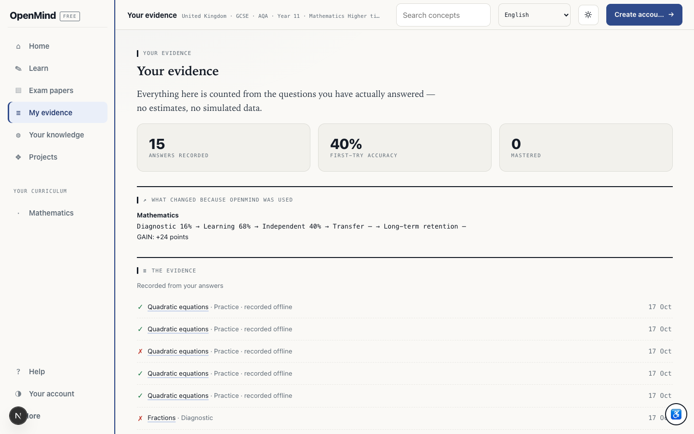

- **Where** `/progress`, "MASTERY PER CONCEPT" rows for *Fractions* and *Fraction arithmetic*; state in `profiles.json`.
- **Repro** `/progress` · 1440×900 · after the diagnostic, read the MASTERY PER CONCEPT rows, then read the matching record in `profiles.json`.
- **Observed** Both rows print `66%` mastery beside `0/2` correct. Read from the scratch store:
  `{"attempts":2,"correct":0,"mastery":0.66,"accuracy":0.66,"independent":{"asked":2,"correct":0}}`.
  The value comes from the sitting's own ladder seed: `diagnosticToProgress` writes `ladderMastery(c)`
  into **both** `mastery` and `accuracy`, so a concept answered 0/2 is stored at 0.66 by
  construction, and `mergeDiagnosticSeed` then keeps it with `Math.max`, so a later wrong answer
  cannot pull it down either. `ladderMastery`'s own comment says the opposite is required:
  *"An all-wrong sitting must not collect the credit for a band its own answers never touched."*
  (The guard it describes is not holding for this configuration — worth stepping through
  `bandsFor(c.conceptId)` / `openedAt` for `fractions` to see which rungs the sitting was credited.)
- **Impact** The product's central claim is that its numbers are evidence. A learner who failed
  both fraction questions is shown as two-thirds of the way to mastery, and the class average and
  "Mastered 0" on the same page disagree with the row above them. A teacher reading this would
  teach the wrong thing.
- **Fix** Seed `accuracy` from the sitting's correctness, not from `ladderMastery`'s position
  score (`lib/diagnostic.ts#diagnosticToProgress`); merge `mastery` as *evidence-weighted*, not
  `Math.max` (`#mergeDiagnosticSeed`); and assert in `npm run verify` that an all-wrong concept
  can never be shown above the "not established" bar.
- **Verify** Answer every question of one concept wrongly in a diagnostic, then read `/progress`
  and `profiles.json`: `correct === 0` must imply a mastery below the engine's established bar
  for that concept. Add the fixture to the engines suite (`lib/mastery.ts` is already compiled
  there).

### 2 · Home's "YOUR GOAL" recommends primary arithmetic to a GCSE Higher learner
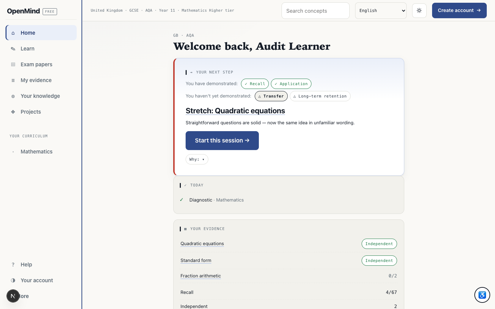 · 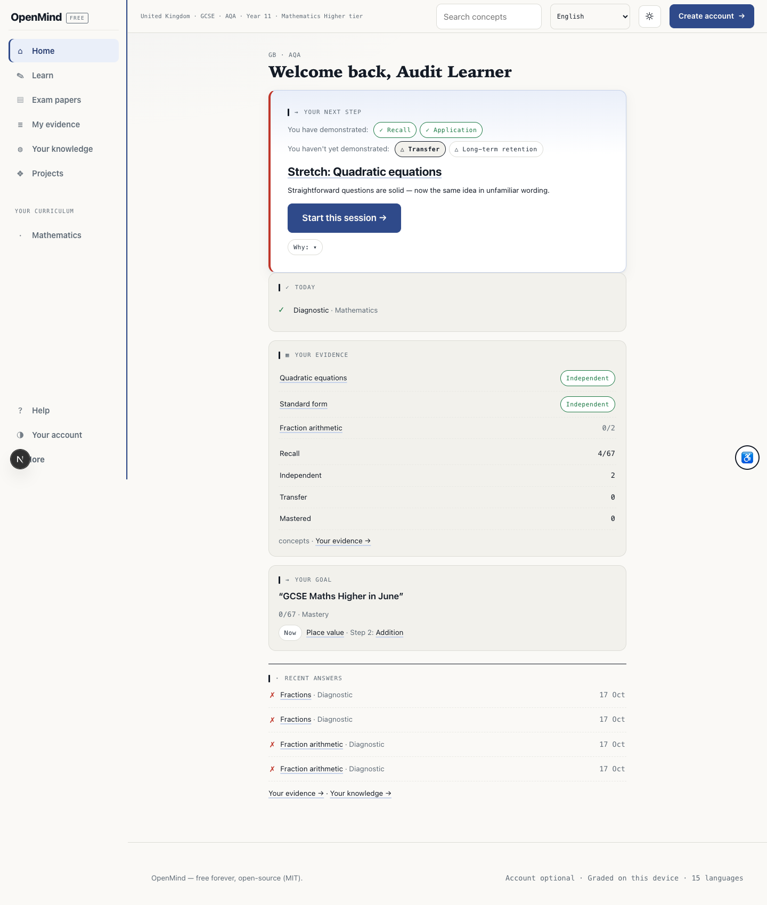

- **Where** `/dashboard`, the `goal.now` line: *"Now **Place value** · Step 2: **Addition**"*.
- **Repro** `/dashboard` · 1440×900 · same learner; compare Home's `goal.now` line with the NextStep card above it.
- **Observed** The page's primary card says **"Stretch: Quadratic equations — Start this session"**,
  and 900px below it the goal card says the next thing to learn is place value, then addition.
  `components/learner-home.tsx` computes it as `bySubject(goalSubject).filter(mastery < 0.9)[0]` —
  the **first concept in genome order**, not the learner's path and not their evidence. Because
  `place-value` and `addition` are the first two entries in `lib/genome.ts`, every learner with a
  stated goal sees this pair, whatever their course.
- **Impact** Two contradictory instructions on one screen, one of them obviously wrong for the
  declared course. A learner who follows the goal line is sent to stage-0 arithmetic after
  failing quadratics — the clearest possible signal that the app is not paying attention.
- **Fix** Take the next step from the same source as `NextStep` (`lib/next-engine.ts#decide` /
  the path returned by `/api/path`) and label it as *the plan's* next step, or drop the "Now"
  line until it can be derived from the path.
- **Verify** With a GCSE Higher profile that has diagnostic evidence, the goal line's concept id
  must equal the `Start this session` target; assert it in `npm run verify:ui` (the walk already
  drives this page).

### 3 · Every answer taken online is labelled "recorded offline"

- **Where** `/progress`, "THE EVIDENCE" list: *"Quadratic equations · Practice · **recorded offline**"*
- **Repro** `/progress` · 1440×900 · open "THE EVIDENCE" and read the provenance on the practice rows; cross-read the event in the ledger.
  on all five practice answers of this sitting.
- **Observed** Those answers were submitted live to `/api/progress` and the route graded them
  (`provenance: "server"`). The scratch ledger confirms it:
  `{"provenance":"server", "deviceAt":1792250950812, …}`. But `lib/api/client.ts#answerQuestion`
  always sets `deviceAt = Date.now()`, and `lib/evidence.ts#isDeviceReported` treats *any*
  `deviceAt` as device-reported, so the disclosure fires for the ordinary case and never for the
  case it was written for.
- **Impact** The page states as fact that nobody verified the answer — the opposite of what
  happened — and it does so on every line. It also quietly discredits the evidence the
  recommendations are built on.
- **Fix** Distinguish *the device supplied a timestamp* from *the device supplied the grade*:
  mark device-reported only when the event arrived from the offline queue (`provenance: "device"`),
  not merely because a client clock rode along.
- **Verify** Answer a question online and `/progress` must show `Practice` with no "recorded
  offline"; then queue one with the browser offline and flush it, and that one must show it.
  A unit fixture in `lib/evidence.ts` already distinguishes the two shapes.

### 4 · A guest "teacher" is enrolled as a learner and dropped into the maths diagnostic
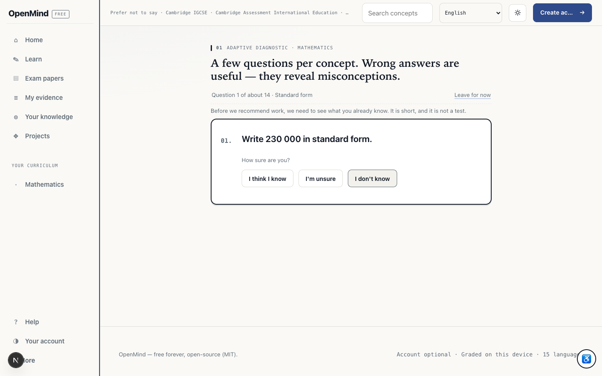

- **Where** `/teacher` → *Create a teacher account* → *Continue without an account* → step 2 → step 3 → **Teacher tools →**
- **Repro** `/onboarding?role=teacher&mode=signup` · 1440×900 · teacher radio + *Continue without an account* → Next ×2 → *Teacher tools →*; read the landing URL.
- **Observed** The wizard's own lead promises *"You are not put through a learner's setup or a
  baseline diagnostic"*. Pressing the final button landed on `/diagnostic/maths` — the learner
  sitting, Question 1 of about 14, standard form. The stored profile has no role at all: the
  teacher flag lives only on an `Account`, so a guest "teacher" is a plain learner.
- **Impact** The teacher path's headline promise is broken on its cheapest route, and the created
  record is a learner record — the teacher is now measured, and their class work has nowhere to go.
- **File** [`app/onboarding/page.tsx`](../../app/onboarding/page.tsx) (`finish`, `steps`, `isTeacherAccount`)
- **Fix** Either hide *Continue without an account* when the role is teacher, or carry the role on
  the guest profile and resolve the destination from it (`homeRouteFor` already knows a teacher's
  home). Do not let the copy promise a route the code cannot take.
- **Verify** Repeat the path; the destination must be `/teacher` with a class-creation form. A
  `verify:ui` step asserting the landing URL after the teacher wizard would have caught it.

### 5 · `/teacher` shows the whole teacher console to any visitor with a profile
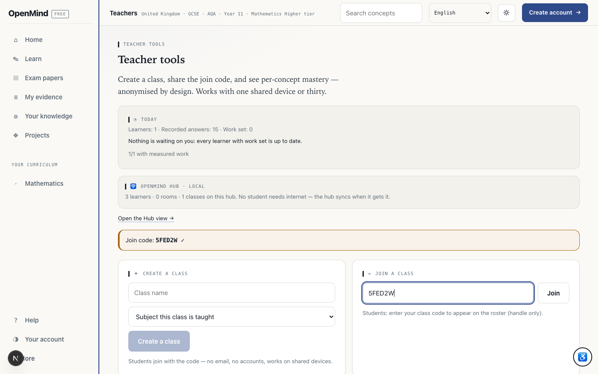

- **Where** `/teacher`, with a **learner's** profile in `localStorage`.
- **Repro** `/teacher` · 1440×900 · opened with the **learner's** profile in `localStorage`; read the join code and activity lines.
- **Observed** `lib/app-state.ts` classifies `/teacher` as `public` (correct — it is the marketing
  page). But once any profile exists the same route renders the console: a join code (`5FED2W`),
  *"Learners: 1 · Recorded answers: 15"*, *"1/1 with measured work"*, and a working *Create a
  class* button. This learner had just joined a class and was then reading that class's activity.
- **Impact** On the stated deployment (one shared device, thirty learners — the hub model), any
  student can read another class's join code and see its activity, and can create a class that
  appears in the teacher's hub. The gate the page shows to a *fresh* browser is not the gate.
- **Fix** Split the public marketing page from the console: require a teacher **account**
  (`session.account.role === "teacher"`) for the console section, and keep the join-a-class box on
  a student route (`/account`, where it already exists for account holders).
- **Verify** With a learner profile, `/teacher` must contain no join code and no roster; assert
  this in `scripts/verify-permissions.mjs` alongside the existing role checks.

### 6 · The roster's MASTERY column is empty, under a "CHOOSE A NICKNAME" header that has no control
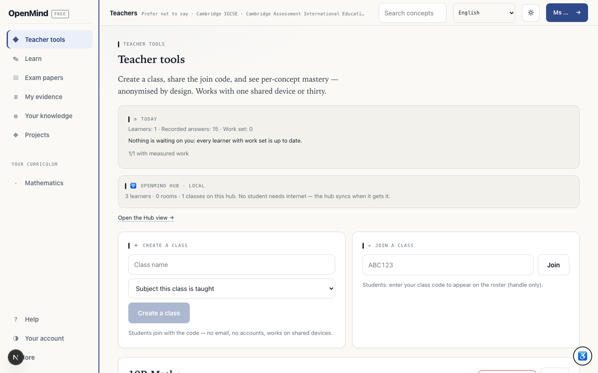

- **Where** `/teacher`, class card "10B Maths", "CLASS ROSTER" table.
- **Repro** `/teacher` · 1440×900 · teacher account `t2`, class "10B Maths" with one joined student; read the CLASS ROSTER table cells.
- **Observed** Headers `CHOOSE A NICKNAME | MASTERY | FOCUS | RECORDED ANSWERS`; the single row
  reads `Audit Learner | (blank) | Fraction arithmetic (0% · 0/2) | 15 | View evidence`, while
  the card's summary line says *"1 student · Class average: 24%"*. So the page computes a class
  average but shows no per-student mastery, and offers no nickname control at all.
- **Impact** This is the teacher's main decision surface, and the one number it exists to show is
  blank. "Anonymised by design" reads as an unbuilt feature rather than a policy.
- **File** [`app/teacher/page.tsx`](../../app/teacher/page.tsx) — the class card's roster table
- **Fix** Render the student's mastery (the profile's own fold, or the class average until there
  is enough evidence) in the cell, and either add the nickname control the header promises or
  rename the column to what it shows.
- **Verify** `/teacher` with one joined student must show a numeric or explicitly "not yet
  measured" mastery per row; a DOM assertion in `scripts/ui-walk-teacher.mjs` is the natural place.

### 7 · The practice question sits ~2,000px below where "Start this session" lands
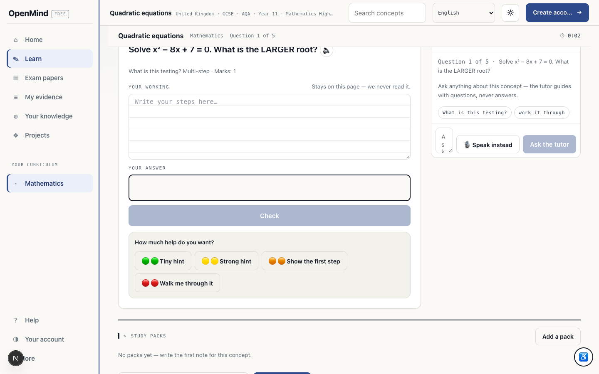 · 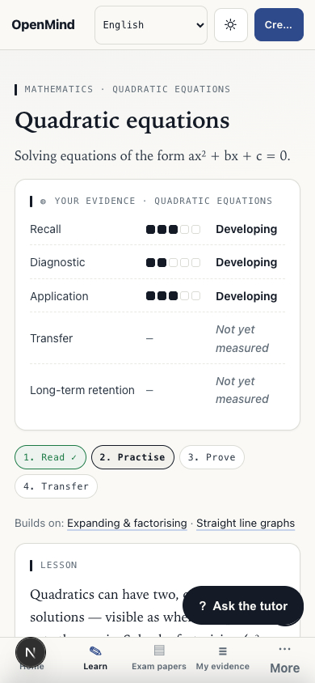

- **Where** `/learn/maths/quadratics` (and every concept page), reached from Home's primary CTA.
- **Repro** `/learn/maths/quadratics` · 1440×900 and 390×844 · arrived from Home's *Start this session*; measure the session heading's document `top`.
- **Observed** Measured in the phone viewport: the learning session starts at **y ≈ 1,976** in a
  3,422px page, after the evidence panel, the lesson, "Teach someone else", the misconceptions
  block and a **second** "YOUR EVIDENCE" panel.  The CTA links to `/learn/…` with no anchor, so it
  opens at the top. On desktop the first question starts at y ≈ 1,523 of a 2,070px page — one and
  a half screens down.
- **Impact** "Start this session" starts nothing. The learner must scroll two to three screens past
  read-only material to find the task they were just promised, and the page repeats the same
  heading twice on the way.
- **File** [`app/learn/[subject]/[concept]/page.tsx`](../../app/learn/%5Bsubject%5D/%5Bconcept%5D/page.tsx)
- **Fix** Make the session the first thing a `?session=1` (or the CTA) lands on — scroll/focus to
  it, or render the question above the lesson for that entry — and remove the duplicated
  "YOUR EVIDENCE" block.
- **Verify** Click *Start this session* from Home and assert the question heading is inside the
  first viewport at both 1440×900 and 390×844.

### 8 · The diagnostic asks "How sure are you?" before there is anything to be sure about
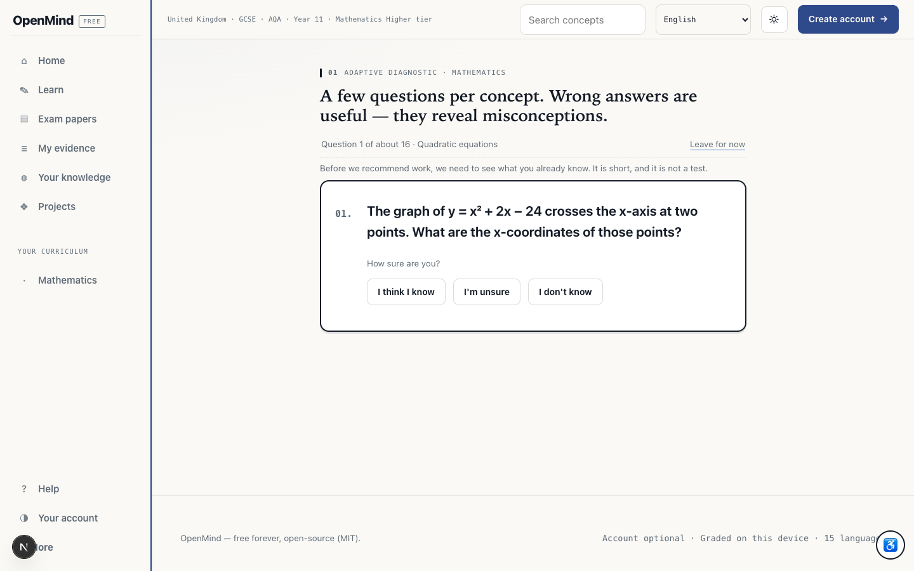 · 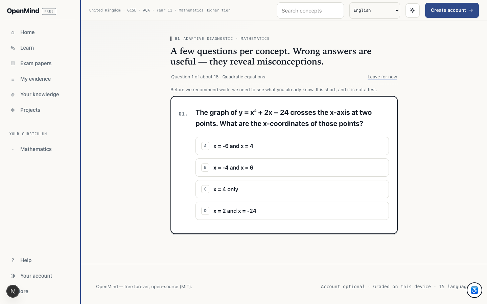

- **Where** `/diagnostic/maths`, every question, before the first answer.
- **Repro** `/diagnostic/maths` · 1440×900 · first question, before choosing a certainty; count `button.choice` in the DOM.
- **Observed** The stem and `How sure are you? / I think I know / I'm unsure / I don't know` are on
  screen; the four answer options **do not exist in the DOM** (`document.querySelectorAll` finds
  none, page height = viewport height). They appear only after a certainty is chosen. The design
  intent is sound — commit the self-report before the choices — but nothing on screen says so.
- **Impact** A first-time learner is asked to rate their confidence in an answer they have not
  been shown, with no visible next step. The natural reading is "the options failed to load", and
  the escape hatch (`I don't know`) ends the question rather than revealing the options.
- **File** [`app/diagnostic/[subject]/page.tsx`](../../app/diagnostic/%5Bsubject%5D/page.tsx)
- **Fix** One sentence above the control: *"Choose how sure you are — then the four answers
  appear."* (`diag.certaintyHint`, authored in all 15 dictionaries).
- **Verify** Assert the sentence is present, and that the options remain absent until a certainty
  is committed (both already observable from the DOM).

### 9 · The maths paper is listed twice, and a board the learner did not choose is offered
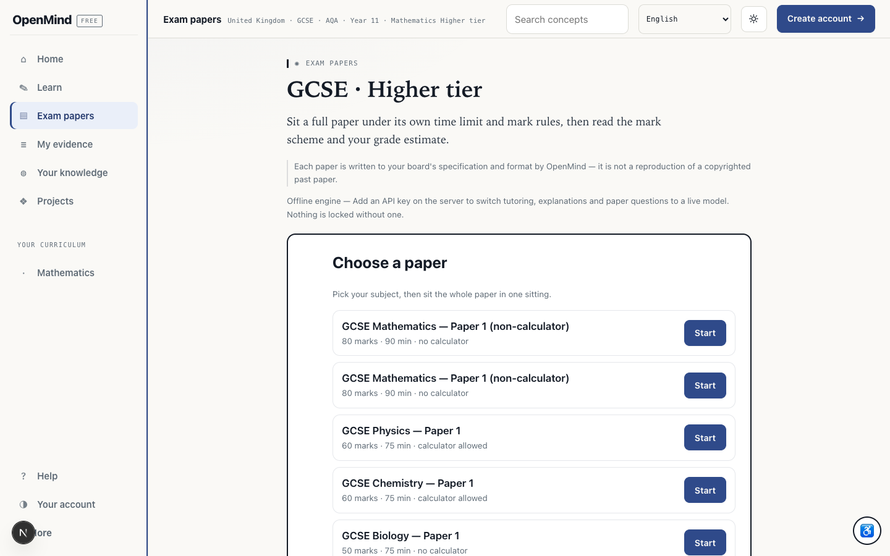

- **Where** `/papers`, "Choose a paper".
- **Repro** `/papers` · 1440×900 · *Choose a paper*; count the rows and their names.
- **Observed** `GCSE Mathematics — Paper 1 (non-calculator) · 80 marks · 90 min · no calculator`
  appears **twice** with identical text and two Start buttons. `lib/papers.ts` declares
  `aqa-gcse-maths-p1` and `edexcel-gcse-maths-p1` with the same `name` (lines 77 and 86), and
  `papersForSpec` returns every paper for the specification regardless of the learner's board —
  this learner chose AQA.
- **Impact** Two papers that look identical but are not; the learner cannot tell which board they
  are sitting, and the AQA learner may sit an Edexcel paper believing it is theirs.
- **Fix** Name the board in the row (or group by board and filter to the declared one), and
  de-duplicate by name when the names are genuinely the same.
- **Verify** For an AQA GCSE profile, `/api/paper?list=1` must return one maths paper, and its name
  or subtitle must identify its board.

### 10 · The same four words mean two different things on two consecutive screens
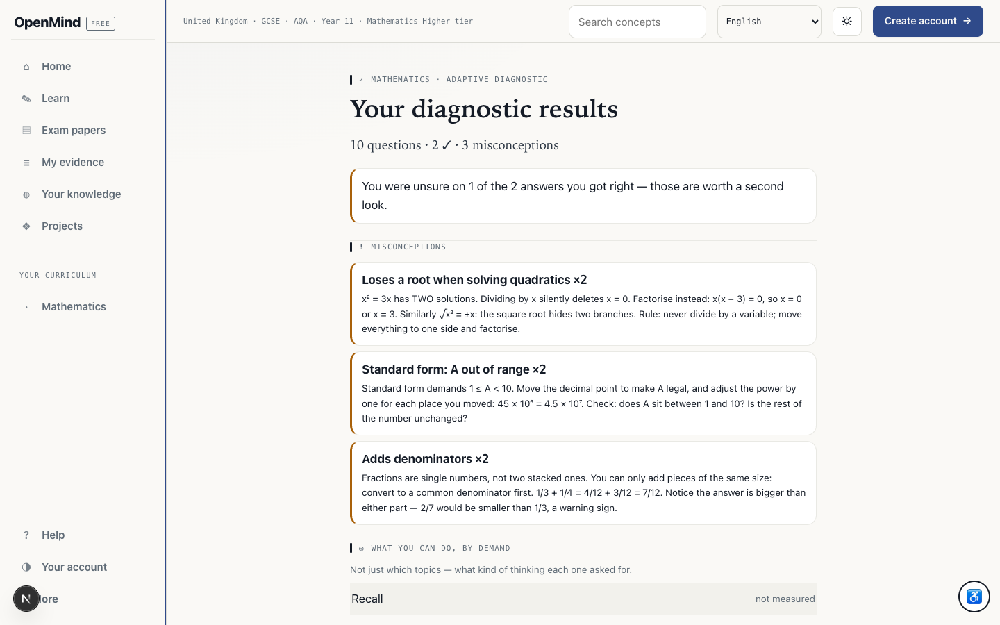 · 

- **Where** `/diagnostic/maths` → "WHAT YOU CAN DO, BY DEMAND", then `/dashboard` → "YOUR NEXT STEP".
- **Repro** `/diagnostic/maths` → `/dashboard` · 1440×900 · finish the sitting, then read Home's demonstration chips.
- **Observed** The results page lists `Recall — not measured` and `Application — not measured`
  (and explains that the course starts above them). The next screen says
  *"You have demonstrated: ✓ Recall ✓ Application"*. Both are true of different instruments —
  demand bands vs. the demonstration rungs of the concept in hand — but the labels are identical.
- **Impact** A learner reads a contradiction about themselves within one click, on the two screens
  that are supposed to establish trust in the model.
- **File** [`app/diagnostic/[subject]/page.tsx`](../../app/diagnostic/%5Bsubject%5D/page.tsx) and
  [`components/next-step.tsx`](../../components/next-step.tsx)
- **Fix** Give one of the two vocabularies its own words (the demand table could say "Recall
  questions", the rungs "You have shown…"), or qualify each with its scope ("for Quadratic
  equations").
- **Verify** `npm run verify` already asserts i18n key coverage; add an assertion that the two
  surfaces do not share a bare label.

### 11 · Three different accuracy numbers, none of them labelled by scope
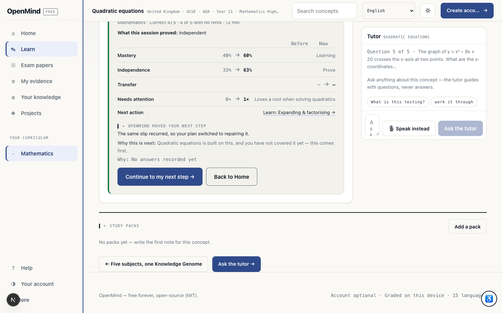 · 

- **Where** session header on `/learn/maths/quadratics`, the summary panel, `/progress` header,
- **Repro** `/learn/maths/quadratics`, `/progress`, `/teacher` · 1440×900 · read the three figures for the same learner in one pass.
  and the teacher's class card.
- **Observed** The session header prints `60% · 8 ✕ · ✓×2` while the summary directly below reads
  `Correct 4/5`; `/progress` prints `40% FIRST-TRY ACCURACY`; the teacher sees
  `Class average: 24%` for the same learner, and the concept page prints `Independent accuracy: 33%`.
  Every figure is defensible from its own scope; none says what its scope is.
- **Impact** The learner cannot tell what improved, and the teacher cannot reconcile the class
  number with the student's record. Numbers that cannot be reconciled read as invented.
- **File** [`app/progress/page.tsx`](../../app/progress/page.tsx),
  [`app/learn/[subject]/[concept]/page.tsx`](../../app/learn/%5Bsubject%5D/%5Bconcept%5D/page.tsx),
  [`app/teacher/page.tsx`](../../app/teacher/page.tsx)
- **Fix** Label each: "this session 4/5", "across this concept 60%", "first-try, all subjects 40%",
  "class mean of each student's concept mastery 24%".
- **Verify** A copy assertion that each statistic on these surfaces carries a scope word, plus a
  `verify:ui` check that the session header changes when the session does.

### 12 · Plural and freshness bugs in the hub and results copy
 · 

- **Where** `/teacher` hub panel; `/diagnostic/maths` "WHAT WE FOUND".
- **Repro** `/teacher` · 1440×900 · create a class and read the hub line **before and after** a reload; `/diagnostic/maths` results for the demand plural.
- **Observed** `1 classes on this hub`; `1 demand levels were not measured by this diagnostic`.
  Also: immediately after creating a class the panel still read `0 classes on this hub` and only
  said `1` after a reload.
- **Impact** Small, but these are the strings a teacher reads first, and the stale counter makes a
  successful create look like a failure.
- **File** [`app/teacher/page.tsx`](../../app/teacher/page.tsx) (hub summary),
  [`app/diagnostic/[subject]/page.tsx`](../../app/diagnostic/%5Bsubject%5D/page.tsx) (demand line)
- **Fix** Pluralise via the existing `fill`/count helpers (`1 class`, `1 demand level`), and refresh
  the hub summary after a create rather than on mount only.
- **Verify** Create a class and assert the panel updates without a reload; add the two strings to
  the i18n placeholder test.

### 13 · `/learn/maths` is a 7,400px list with no way to narrow it
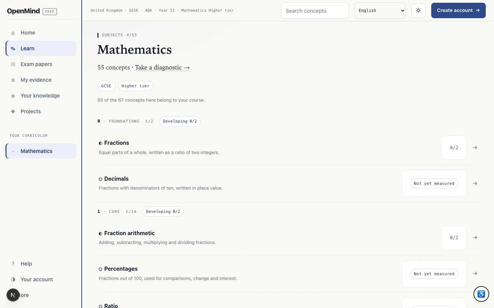

- **Where** `/learn/maths`.
- **Repro** `/learn/maths` · 1440×900 · read `documentElement.scrollHeight` and the first stage group.
- **Observed** 55 concepts, `documentElement.scrollHeight = 7414`, grouped by stage and starting at
  FOUNDATIONS (Fractions, Decimals). Every row ends in a bare `→` link; there is no filter, no
  "my course only", no "unfinished" or "weakest" shortcut, and no jump to the concept the plan
  recommends (quadratics is far below the fold).
- **Impact** A GCSE Higher learner's first view of "Mathematics" is primary arithmetic, and the
  concept they were just told to work on is several screens down. This is where a first-time
  learner most plausibly gives up.
- **File** [`app/learn/[subject]/page.tsx`](../../app/learn/%5Bsubject%5D/page.tsx)
- **Fix** Default to the recommended concept at the top, add a two-state filter (whole course /
  needs work), and give rows an action label rather than an arrow.
- **Verify** With the learner above, the first row group on `/learn/maths` must contain the
  recommended concept, and the list must expose a filter control.

### 14 · Onboarding's primary button is off the bottom of a laptop viewport
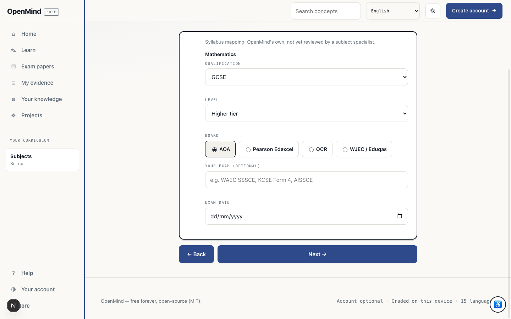 · 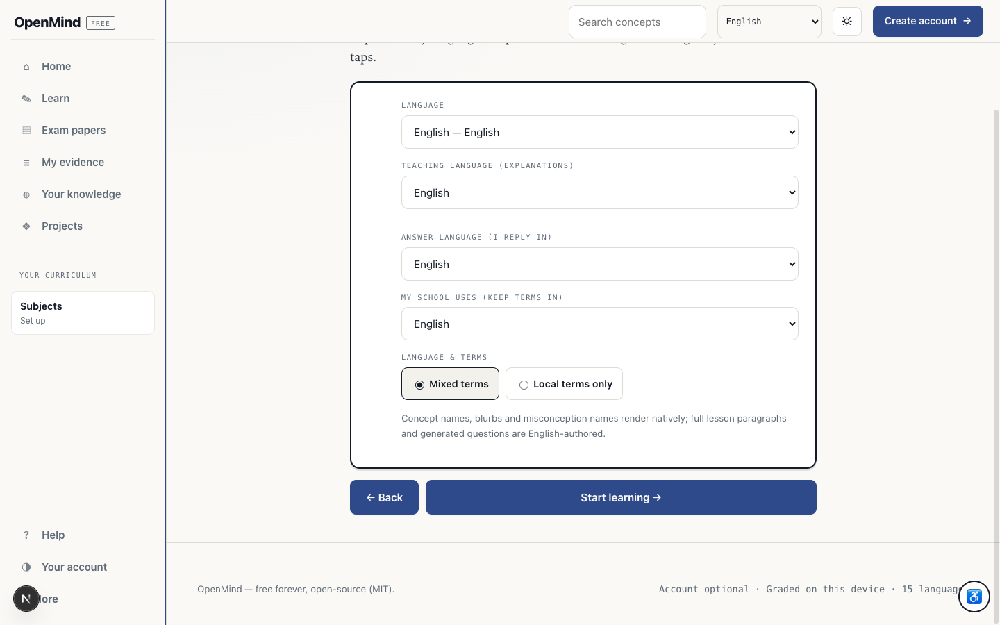

- **Where** `/onboarding` step 4/6 ("Your course") and step 6/6 ("How should OpenMind talk to you?").
- **Repro** `/onboarding` · 1440×900 · steps 4/6 and 6/6; measure the rect of *Next →* / *Start learning →* without scrolling.
- **Observed** At 1440×900 the `Next →` button's box starts at **y = 938** (50px tall), and on step 6
  `Start learning →` at **y = 880** — its lower half is clipped. Both work once scrolled to; neither
  is visible on arrival. A synthetic click at the element's centre misses entirely.
- **Impact** On the two steps that decide the course and the language — the steps the wizard cannot
  finish without — the only way forward is invisible on a common laptop size. This is the shape of
  "the button doesn't work" reports.
- **Fix** A sticky wizard footer for the Back/Next pair, or reduce step-4's vertical rhythm so the
  action lands above 900px.
- **Verify** At 1440×900 and 390×844, `Next`'s rect must be fully inside the viewport on every
  step; easy to add to `scripts/ui-walk.mjs`.

### 15 · Merely opening a concept page creates an "Unfinished session"
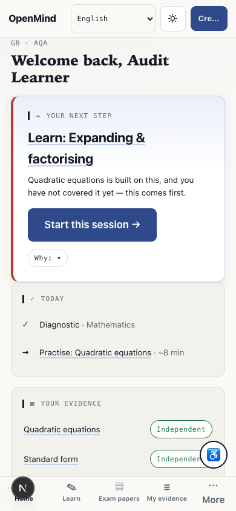

- **Where** Home (phone shown), bottom of the page: `↻ Unfinished session: 0 of 5 · Quadratic equations`.
- **Repro** Home · 390×844 · open a concept page without answering anything, return Home, read the bottom notice.
- **Observed** The notice appeared after *viewing* the concept page — no question answered — because
  opening the page starts a session (the `useRef` guard fires on mount). It then persists on Home
  as a resume prompt for work that never began.
- **Impact** A nag about a session the learner never started, created by navigation alone. It also
  makes "0 of 5" look like a score.
- **File** [`app/learn/[subject]/[concept]/page.tsx`](../../app/learn/%5Bsubject%5D/%5Bconcept%5D/page.tsx)
  (the mount effect that calls `start`) and [`components/learner-home.tsx`](../../components/learner-home.tsx)
  (the notice)
- **Fix** Start the session on the first answer (or first hint), not on mount; only offer to resume
  when at least one answer exists.
- **Verify** Open a concept page, go Home, and assert no resume prompt; answer one question and
  assert the prompt names `1 of 5`.

---

## Measured, and *not* defects

Recorded so the fixed things stay fixed and nobody "repairs" them:

| Property | Measurement | Verdict |
|---|---|---|
| Horizontal overflow, phone | `scrollWidth === clientWidth === 390` on `/dashboard`, `/learn/maths/quadratics`; the only elements past the edge are inside the closed `⋯ More` menu | Pass |
| Muted-text contrast | `rgb(95,107,118)` on `rgb(250,249,246)` = **5.18:1**; on the soft card `rgb(242,241,236)` = **4.82:1** | Passes WCAG AA for normal text |
| Focus ring | Keyboard `Tab` → `outline: 2px solid rgb(47,74,138)` on the first link | Pass |
| Bottom nav vs content | Fixed bar at y=787 (h=57); footer ends at y=780 at full scroll | No overlap (7px clearance) |
| Landmarks / names | one `<main>`, three `<nav>` with distinct accessible names (only one visible per width), no unnamed buttons, no `img` without `alt` | Pass |
| Offline / no-AI state | `/papers` states *"Offline engine — Add an API key on the server… Nothing is locked without one."* | Honest and specific |
| Honesty copy | *"not a reproduction of a copyrighted past paper"*, *"Syllabus mapping: OpenMind's own, not yet reviewed by a subject specialist"*, *"You were unsure on 1 of the 2 answers you got right"* | Consistent with the audit's position |

## Subjective improvements (not defects)

1. **Density on the concept page.** Five read-only blocks before the task, two headed
   "YOUR EVIDENCE". Splitting the lesson and the session into two states would do more for
   comprehension than any styling change.
2. **11–11.5px labels.** `GB · AQA`, `Now`, `Why: ▾` and the chip captions are small for a phone in
   a classroom; 13px would cost little.
3. **Inline tap targets.** Standalone concept links measure 16px tall (WCAG 2.5.8 asks 24px, and
   44px is the practical bar); expand the hit area rather than the type.
4. **Placeholder-only field names.** *Class name* and the class-code box have no `<label>`; the
   name vanishes once typed.
5. **The 404** is the unbranded Next default (`404 · This page could not be found`) inside the app
   chrome — a route back to Home would cost one line.
6. **Class week plan before any data.** *"Monday — Explain: Place value / Tuesday — Diagnose:
   Addition…"* for a class with no students is a generic primary sequence presented as a plan.

## Not verified (stated, not assumed)

- **The production artefact.** This review drove the **dev server**. Styling, routing and API
  behaviour were not re-checked against the standalone build (`npm run production-check` remains
  unrun here for disk-headroom reasons), and the dev server serves a Next dev-tools button that a
  learner will never see.
- **Real accounts at scale.** Sign-up was exercised with a synthetic address; no email exists, as
  the UI itself says. Session revocation across devices was not tested.
- **The AI paths.** No key is configured, so tutoring, AI-written questions and marking were
  reviewed only in their *unavailable* state (`ai.provider: "offline"`).
- **Screenshots are evidence, not judgement.** Every claim above is backed by DOM measurement or
  stored data; the images are there so a human can see the same state.
- **Not a penetration test.** Finding 5 is an authorisation observation made through the UI, not an
  audit of the API surface.
